# Notenverwaltung – Handbuch

**Für Version 1.2** · Stand November 2026

Die Notenverwaltung führt deine Noten für ein ganzes Schuljahr: Klassenarbeiten und Klausuren mit Punkten,
mündliche Noten, Quartals- und Halbjahresnoten mit Vorschlägen, Rückmeldungen, Sitzpläne und Ausdrucke. Alles
steht in **einer verschlüsselten Datei** auf deinem Rechner. Das Programm stellt keine Verbindung ins Internet her.

Dieses Handbuch folgt dem Ablauf eines Schuljahres: einrichten, Schüler:innen und Lerngruppen anlegen, Arbeiten
korrigieren, mündliche Noten führen, Zeugnisnoten festsetzen, das Jahr abschließen. Die Zahlen ①, ②, … im Text
gehören zu den roten Markierungen in den Bildern. Alle Namen in den Bildern sind erfunden.

Im Programm selbst öffnet **F1** jederzeit die Hilfe zu der Ansicht, in der du gerade bist.

<!-- seitenumbruch -->

## Inhalt

1. Installieren und starten
2. Die erste Datenbank
3. Das Hauptfenster
4. Schuljahr und Quartale
5. Schüler:innen
6. Lerngruppen
7. Klassenarbeiten und Klausuren
8. Rückmeldungen und Textbausteine
9. Drucken: Punkteliste, Notenabschnitte, Rückmeldebögen
10. Mündliche Noten
11. Schnellerfassung je Stunde
12. Sitzplan
13. Noten fürs Zeugnis
14. Oberstufe (EF, Q1, Q2)
15. Übersichten: offene Punkte, Schnellsuche, Nachschreibliste, Schüler:innen-Bogen
16. Schuljahreswechsel
17. Sicherheit und Datensicherung
18. Einstellungen und Darstellung
19. Hilfe, häufige Fragen, Fehler melden
20. Tastenkürzel
21. Anhang: So rechnet das Programm

<!-- seitenumbruch -->

## 1 Installieren und starten

Die Notenverwaltung läuft unter **Windows** und **Linux**. Beide Fassungen öffnen dieselben Dateien – du kannst
eine Datenbank auf einen anderen Rechner kopieren und dort weiterarbeiten.

**Herunterladen:** Auf der Release-Seite des Projekts liegen `Notenverwaltung-windows.zip` und
`Notenverwaltung-linux.zip`. Die Zip-Datei entpacken, zum Beispiel nach *Dokumente* oder *Programme*.

- **Windows:** `Notenverwaltung.exe` im entpackten Ordner starten. Beim ersten Start warnt Windows vielleicht vor
  einer unbekannten App, weil das Programm nicht signiert ist: „Weitere Informationen“ → „Trotzdem ausführen“.
- **Linux:** im entpackten Ordner `./Notenverwaltung` starten (oder per Doppelklick). Unter Wayland läuft das
  Programm sofort; unter X11 braucht es gegebenenfalls das Paket `libxcb-cursor0`.

**Neue Version:** Den alten Programmordner durch den neuen ersetzen. Deine Daten liegen nicht im Programmordner,
sondern dort, wo du die Datenbank gespeichert hast. Neue Versionen öffnen alle älteren Dateien und stellen sie bei
Bedarf um; vorher bleibt die alte Datei als Sicherung erhalten (siehe Kapitel 17).

**Selbsttest:** `Notenverwaltung --selbsttest` prüft Verschlüsselung, Datenbank, PDF und Oberfläche – nützlich,
wenn auf einem Rechner etwas nicht klappt.

> **Datenschutz:** Für Schülerdaten auf privaten Geräten brauchst du in NRW die Genehmigung der Schulleitung
> (VO-DV I). Das Programm unterstützt die technischen Maßnahmen – Verschlüsselung, keine Datenübertragung,
> Sperre –, die Verantwortung für den sorgfältigen Umgang bleibt bei dir.

## 2 Die erste Datenbank

Beim Start erscheint der **Startdialog**. Er zeigt die zuletzt benutzten Datenbanken; Passwort eintippen,
„Öffnen“. Beim allerersten Mal wählst du „Neue Datenbank …“.

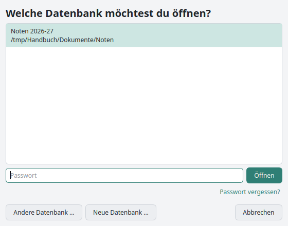

Der Assistent für eine neue Datenbank führt durch vier Schritte:

1. **Datenschutzhinweis** lesen und bestätigen.
2. **Speicherort** wählen. Nicht in einem Cloud-Ordner (Nextcloud, OneDrive, Dropbox …) – das Programm warnt, wenn
   es einen erkennt. Die Datei ist zwar verschlüsselt, würde damit aber den Rechner verlassen.
3. **Passwort** festlegen: mindestens 10 Zeichen. Ein Satz aus mehreren Wörtern ist gut zu merken und sicher.
4. **Notfallblatt** drucken oder als PDF sichern.

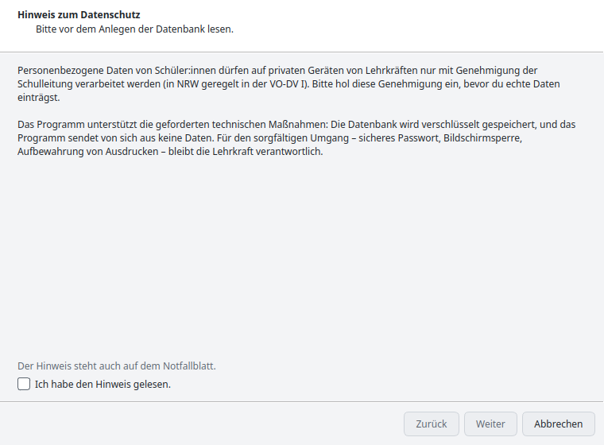

Das **Notfallblatt** enthält den 24-stelligen Wiederherstellungscode (auch als QR-Code). Mit ihm kommst du an deine
Daten, wenn du das Passwort vergisst. Druck es aus und bewahre es sicher auf – nicht neben dem Rechner. Wer
Passwort, Code und Schlüsseldatei verliert, verliert die Daten: Es gibt bewusst keine Hintertür.

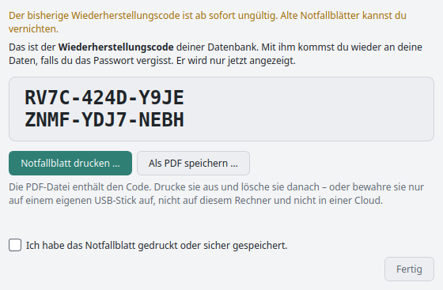

**Andere Datenbank öffnen:** im Startdialog „Andere Datenbank …“ oder Datei → Datenbank öffnen (Strg+O). Öffne
dieselbe Datei nie auf zwei Rechnern gleichzeitig; das Programm warnt, wenn sie schon woanders offen ist.

<!-- seitenumbruch -->

## 3 Das Hauptfenster

Links steht die **Leiste** ①: das Schuljahr, die Liste der Schüler:innen und deine Lerngruppen. Rechts arbeitest du.
Die Seite **Schuljahr** zeigt die **offenen Punkte** ② – was vor der nächsten Notenabgabe noch zu tun ist
(Kapitel 15).

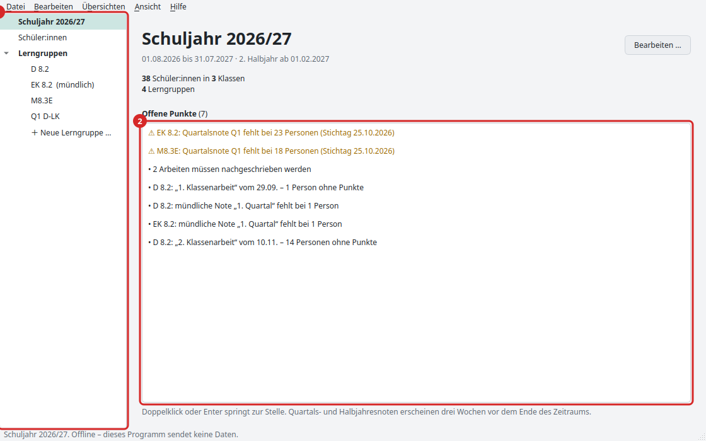

**Speichern:** Das Programm speichert automatisch alle 2 Minuten und beim Schließen. Strg+S speichert sofort.

**Rückgängig:** **Strg+Z** nimmt die letzte Änderung zurück – eine eingetippte Zelle, ein „OK“ in einem Dialog,
auch das Löschen einer Arbeit oder einen ganzen Schuljahreswechsel. **Strg+Y** stellt sie wieder her. Das geht für
alle Änderungen seit dem Öffnen der Datenbank (bis zu 200 Schritte); im Menü Bearbeiten steht, was zurückgenommen
würde.

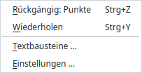

Die **Menüs** im Überblick:

- **Datei:** Datenbank neu, öffnen, speichern, schließen; Schuljahr wechseln oder neu anlegen; neue Lerngruppe
  (Strg+L); Angaben für Ausdrucke; Sicherheit (Kapitel 17).
- **Bearbeiten:** Rückgängig, Wiederholen, Textbausteine, Einstellungen.
- **Übersichten:** Schnellsuche (Strg+F), offene Punkte, Nachschreibliste, Schüler:innen-Bogen (Strg+B).
- **Ansicht:** helles oder dunkles Design, Schriftgröße.
- **Hilfe:** Hilfe zur Ansicht (F1), Inhalt, Tastenkürzel, häufige Fragen, Über.

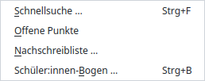

## 4 Schuljahr und Quartale

Nach dem Anlegen der Datenbank schlägt das Programm das laufende Schuljahr vor. Jedes Schuljahr hat einen Beginn,
einen **Halbjahreswechsel** (erster Tag des 2. Halbjahres) und ein Ende. Der Halbjahreswechsel entscheidet, welche
Noten zum 1. und welche zum 2. Halbjahr zählen.

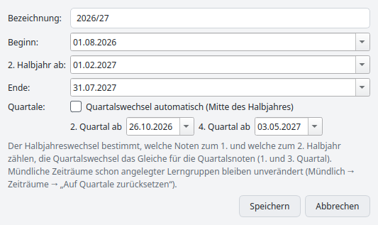

**Quartale:** Standardmäßig liegt der Quartalswechsel in der Mitte jedes Halbjahres. Musst du Quartalsnoten zu
festen Terminen abgeben, nimm unter Datei → Schuljahr → „Schuljahr bearbeiten …“ den Haken „automatisch“ heraus und
trag den Beginn des 2. und 4. Quartals ein. Eine Arbeit zählt zum Quartal ihres Datums, ein mündlicher Zeitraum
zum Quartal, in dem er beginnt.

Zwischen Schuljahren wechselst du über Datei → Schuljahr. Ein neues Schuljahr legst du am besten mit dem
Schuljahreswechsel an (Kapitel 16) – dann ziehen Klassen und Lerngruppen mit.

<!-- seitenumbruch -->

## 5 Schüler:innen

Links „Schüler:innen“ zeigt alle Schüler:innen des Schuljahres mit Klasse und Jahrgang. Der Jahrgang ergibt sich
aus der Klasse: „8.4“ → 8, „10b“ → 10, „EF“ → 11, „Q1“ → 12, „Q2“ → 13.

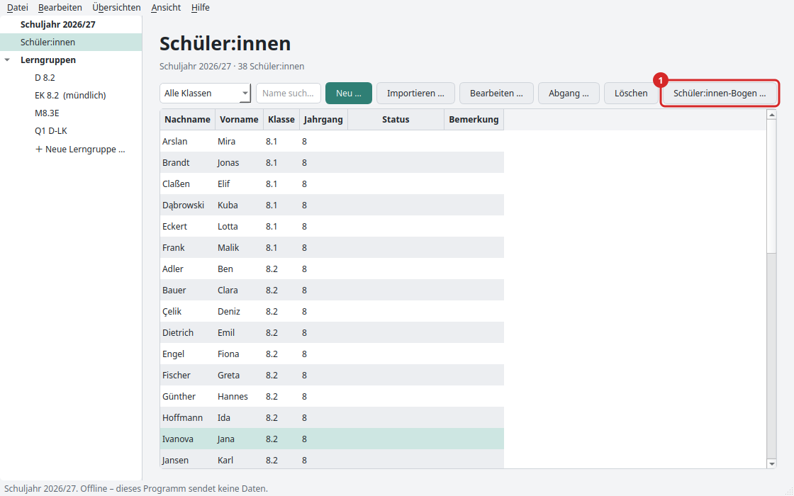

- **Neu …** – einzeln eintragen. Kommt jemand im laufenden Schuljahr dazu, trag den Zugang ein: Für die Zeit davor
  wird keine Note erwartet.
- **Importieren …** – ganze Listen übernehmen (siehe unten).
- **Abgang …** – wer die Schule verlässt, bekommt ein Abgangsdatum. Die Noten bleiben erhalten; danach erscheinen
  die Felder grau, weil keine Eingabe mehr erwartet wird.
- **Schüler:innen-Bogen …** ① – alle Noten der Person auf einen Blick (Kapitel 15).

### Listen importieren

Der Import-Assistent liest **CSV**, **Excel (.xlsx)**, **ODS** sowie Exporte aus **SchILD-NRW** und **Untis**.

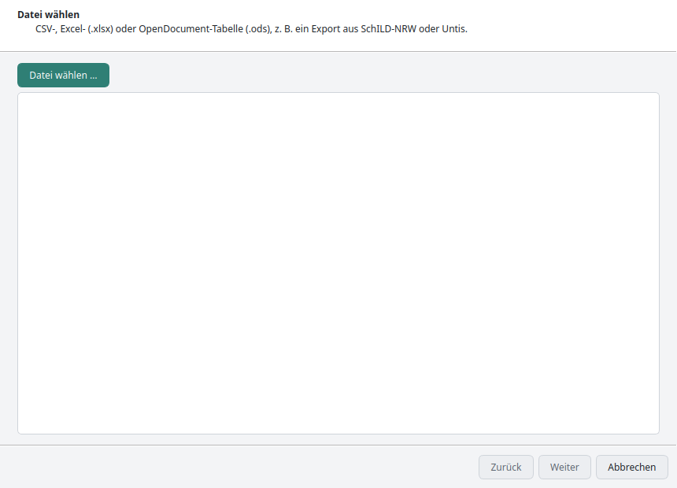

1. **Datei wählen** – Zeichensatz und Trennzeichen erkennt das Programm selbst.
2. **Spalten zuordnen** – Nachname, Vorname, Klasse usw. werden anhand der Spaltenüberschriften vorgeschlagen; jede
   Zuordnung lässt sich ändern. Die Vorschau zeigt, was ankommt.
3. **Abgleich** – wer schon da ist, wird erkannt (über die ID aus SchILD oder über Name und Klasse) und nicht
   doppelt angelegt.

Den Import gibt es auch direkt in einer Lerngruppe („Liste importieren …“); dann landen die Schüler:innen zusätzlich
in dieser Gruppe.

## 6 Lerngruppen

Eine **Lerngruppe** ist entweder eine **Klasse in einem Fach** (z. B. „D 8.2“) oder ein **klassenübergreifender
Kurs** (z. B. „M8.3E“). Neu anlegen: Datei → Neue Lerngruppe (**Strg+L**) oder links „+ Neue Lerngruppe …“.

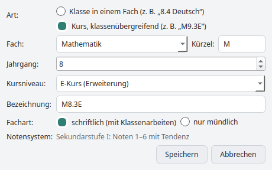

- **Fach und Kürzel** – das Kürzel erscheint in Bezeichnungen und Ausdrucken.
- **Jahrgang** – ab Jahrgang 11 (EF) gibt es Punkte statt Noten (Kapitel 14).
- **Kursniveau** (Sek I): E- oder G-Kurs, wird vermerkt. **Kursart** (Oberstufe): GK oder LK.
- **Fachart:** schriftlich (mit Klassenarbeiten bzw. Klausuren) oder nur mündlich.

Bei einer Klasse kannst du gleich alle Schüler:innen der Klasse aufnehmen.

Jede Lerngruppe hat Reiter ①: **Klassenarbeiten**, **Mündlich**, **Schnellerfassung**, **Sitzplan**, **Noten** und
**Schüler:innen**. Bei nur mündlichen Fächern fehlt der Reiter Klassenarbeiten.

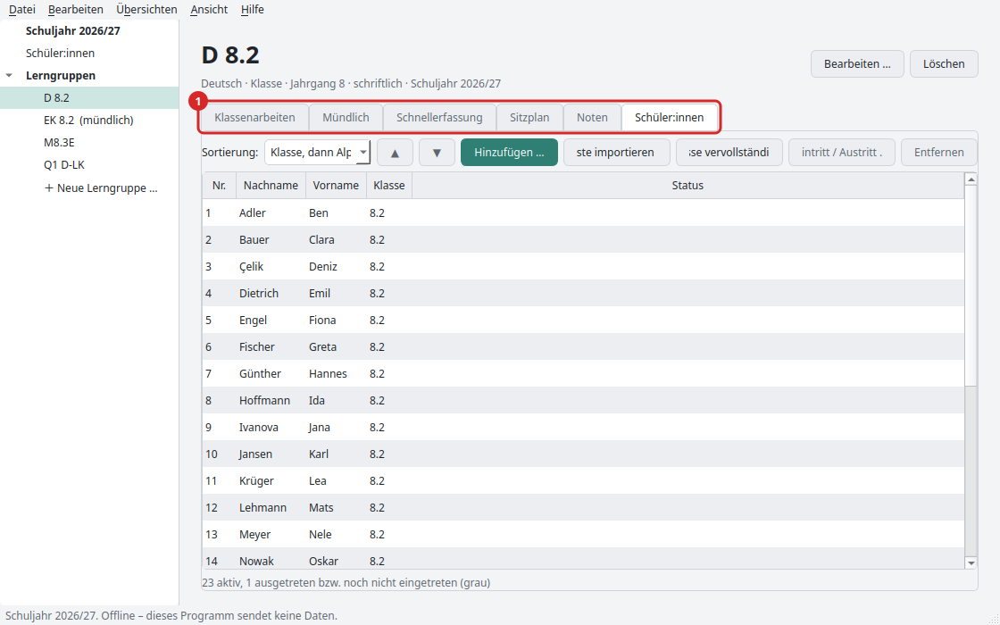

Im Reiter **Schüler:innen**:

- **Hinzufügen …** – weitere Schüler:innen aufnehmen (Mehrfachauswahl mit Strg oder Umschalt).
- **Eintritt / Austritt …** – wer später dazukommt oder die Gruppe verlässt, bekommt ein Datum. Vorher bzw. danach
  wird keine Note erwartet.
- **Sortierung:** Klasse, dann Alphabet (Standard), nur Alphabet oder eine eigene Reihenfolge (mit ▲ ▼). Sie gilt für
  alle Listen und Ausdrucke der Gruppe.

<!-- seitenumbruch -->

## 7 Klassenarbeiten und Klausuren

Im Reiter **Klassenarbeiten** wählst du oben die Arbeit ①. Die Tabelle ② enthält je Person die Punkte aller
Aufgaben, Summe und Note. Rechts stehen der **Notenspiegel** ③ und – wenn eingeschaltet – die
**Aufgabenanalyse** ④.

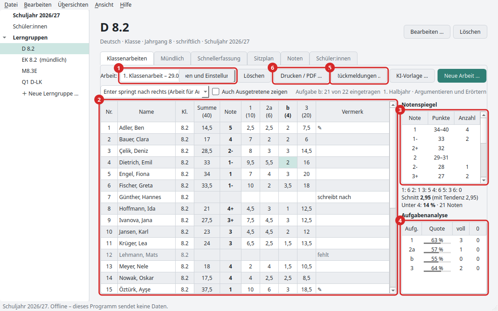

### Eine Arbeit anlegen

„**Neue Arbeit …**“ öffnet den Dialog für Titel, Datum, Aufgaben und Notenschlüssel.

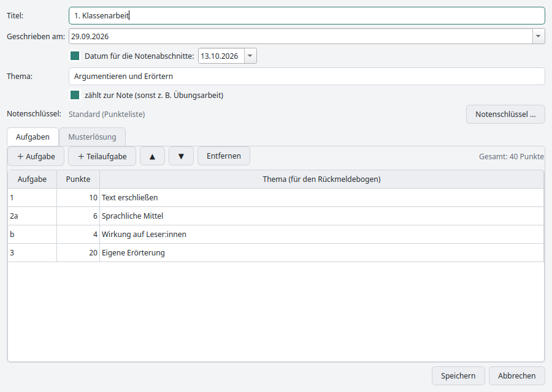

- **Datum** – bestimmt Halbjahr und Quartal und wer teilnimmt (wer an dem Tag in der Gruppe war).
- **Datum für die Notenabschnitte** – das Rückgabedatum, das auf Abschnitten und Rückmeldebögen steht.
- **Thema** der Arbeit und **zählt zur Note** (sonst z. B. eine Übungsarbeit). Unter „Aufgaben und Einstellungen …“
  lässt sich später auch ein **Gewicht** einstellen.
- **Aufgaben:** „+ Aufgabe“ und „+ Teilaufgabe“ – Teilaufgaben heißen wie in einer Punkteliste „3a“, dann „b“,
  „c“. Je Aufgabe Höchstpunkte, ein kurzes **Thema** (erscheint auf Rückmeldebögen und in der Aufgabenanalyse) und
  auf Wunsch ein **Erwartungshorizont**.
- **Musterlösung** im zweiten Reiter.

### Der Notenschlüssel

Der Schlüssel legt fest, ab welchem Anteil der Höchstpunkte es welche Note gibt. Standard ist die Prozenttabelle
der bewährten Punkteliste. Die Punktgrenzen siehst du sofort; gerundet wird wie in einer Tabellenkalkulation, auf
Wunsch auf halbe oder Viertelpunkte.

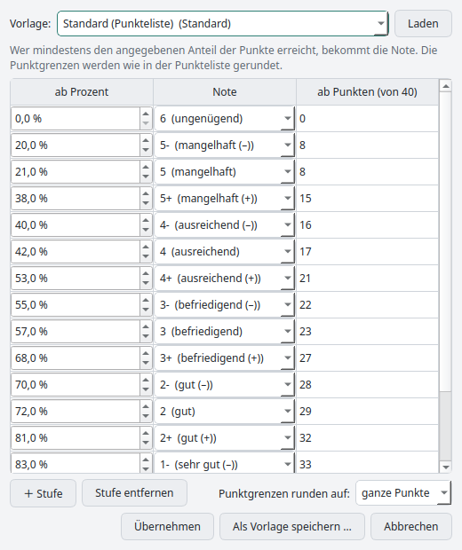

Jede Arbeit hat ihre **eigene Kopie** des Schlüssels: Änderungen an Vorlagen verändern keine alten Noten. „Als
Vorlage speichern …“ macht einen Schlüssel für weitere Arbeiten verfügbar; eine Vorlage kann der Standard für neue
Arbeiten sein.

### Punkte eintragen

Einfach lostippen: **Enter** übernimmt und springt weiter. Halbe und Viertelpunkte gehen (2,5 oder 2,25); zu viele
Punkte lehnt das Programm ab. Summe und Note erscheinen sofort, der Notenspiegel rechnet mit.

- **Richtung:** oben „Enter springt nach rechts (Arbeit für Arbeit)“ oder „nach unten (Aufgabe für Aufgabe)“.
  Beim aufgabenweisen Korrigieren geht es nach der letzten Person mit der ersten Person der nächsten Aufgabe weiter;
  daneben steht z. B. „Aufgabe 2a: 17 von 22 eingetragen“. Die Wahl bleibt gespeichert.
- **Tab** springt seitlich, **Entf** leert markierte Felder, **Esc** bricht eine Eingabe ab.
- Farbig hinterlegt: Bei dieser Person fehlen noch Aufgaben.

**Rechtsklick auf eine Zeile:** *fehlt*, *schreibt nach*, *befreit*, Note festsetzen, Rückmeldung an die Person.

**Note ohne Punkte** – etwa bei einer Nachschreibarbeit: die Note direkt in die Spalte „Note“ tippen (2, 3+, 4-).
Ein \* markiert eine festgesetzte Note, **Entf** hebt die Festsetzung auf. Abschnitt und Rückmeldebogen zeigen dann
nur die Note.

Schüler:innen erfahren bei Klassenarbeiten die Note **ohne Tendenz** („gut“). Intern rechnet das Programm mit
Tendenz (2+ = 1,7; 2- = 2,3).

### Aufgabenanalyse

Unter Bearbeiten → Einstellungen einschaltbar (Kapitel 18). Je Aufgabe ④ steht die **Lösungsquote** – der mittlere
Anteil der Höchstpunkte –, wie viele die volle Punktzahl und wie viele 0 Punkte haben. Niedrige Quoten sind rot,
hohe grün. So siehst du schnell, was im Unterricht noch einmal dran sein sollte. Im Druckdialog gibt es die
Analyse als eigenen Ausdruck ohne Namen, etwa für die Fachkonferenz.

### KI-Vorlage

Für Arbeiten, die du mit einer KI vorbereitest, liefert „**KI-Vorlage …**“ eine fertige Anweisung. Du kopierst sie
in die KI deiner Wahl, ergänzt deine Arbeit oder das Thema und fügst die Antwort im zweiten Reiter wieder ein.
Das Programm liest daraus Aufgaben, Punkte, Themen, Erwartungshorizont und Musterlösung.

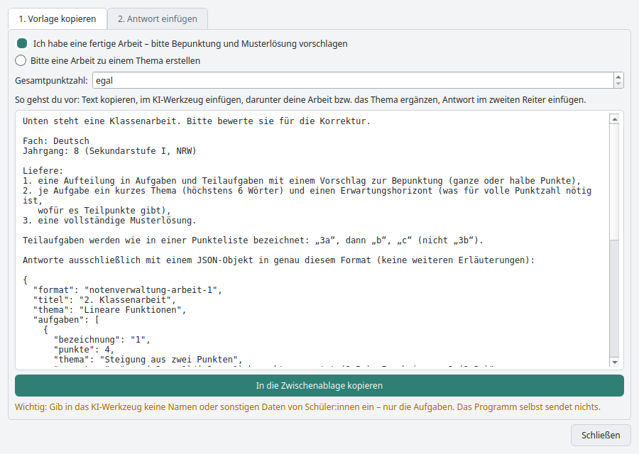

Das Programm selbst sendet nichts – du kopierst von Hand. **Gib der KI keine Schülerdaten**; die Vorlage enthält
keine.

<!-- seitenumbruch -->

## 8 Rückmeldungen und Textbausteine

„**Rückmeldungen …**“ (⑤ im Bild in Kapitel 7) oder Rechtsklick → „Rückmeldung an die Person …“ öffnet ein Fenster,
in dem du Person für Person schreibst. Die Rückmeldung erscheint auf dem Rückmeldebogen.

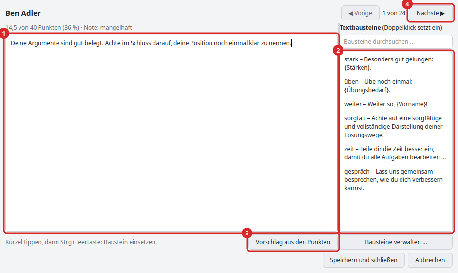

- **Text** ① – oben stehen Punkte und Note der Person.
- **Textbausteine** ② – Doppelklick setzt einen Baustein an der Schreibmarke ein. Schneller: **Kürzel tippen und
  Strg+Leertaste** – aus „stark“ wird „Besonders gut gelungen: …“.
- **Vorschlag aus den Punkten** ③ (einschaltbar) – ein Satz aus den Aufgabenergebnissen, z. B. „Besonders gut
  gelungen: Text erschließen. Übe noch einmal: Eigene Erörterung.“ Nur ein Vorschlag zum Weiterschreiben.
- **Vorige / Nächste** ④ (Strg+Bild auf / Strg+Bild ab) speichert und blättert.

**Platzhalter** in Textbausteinen werden für jede Person ersetzt: {Vorname}, {Nachname}, {Note}, {Punkte},
{Höchstpunkte}, {Prozent}, {Arbeit}, {Fach}, {Stärken}, {Übungsbedarf}. *Stärken* und *Übungsbedarf* nennen die
Themen der Aufgaben mit vielen bzw. wenigen Punkten (Standard: ab 80 % bzw. unter 50 %).

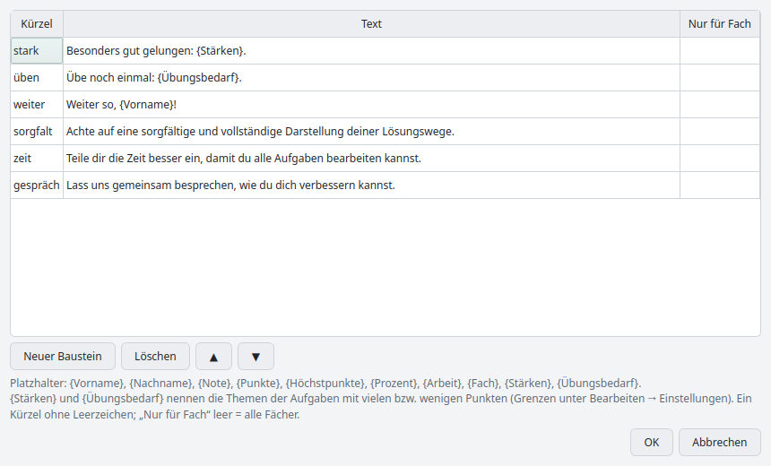

Verwalten kannst du die Bausteine im Rückmeldungsfenster („Bausteine verwalten …“) oder unter Bearbeiten →
Textbausteine. Ein Baustein kann für alle Fächer oder nur für eines gelten. Die Bausteine stehen in der
Datenbank – auf jedem Rechner dieselben.

## 9 Drucken: Punkteliste, Notenabschnitte, Rückmeldebögen

„**Drucken / PDF …**“ im Reiter Klassenarbeiten öffnet die Druckvorschau. Links wählst du, was gedruckt wird,
rechts siehst du das Ergebnis. „Als PDF speichern …“ legt eine PDF-Datei an. Sie enthält Noten: nicht in einer
Cloud ablegen und nach dem Drucken löschen.

**Punkteliste** (für dich, Querformat): alle Punkte, Summe, Note, Notenspiegel und Schlüssel. Optionen: leere
Zeilen ausblenden, Noten mit Tendenz, schwache Noten und fehlende Einträge hervorheben, Durchschnitt je Aufgabe.

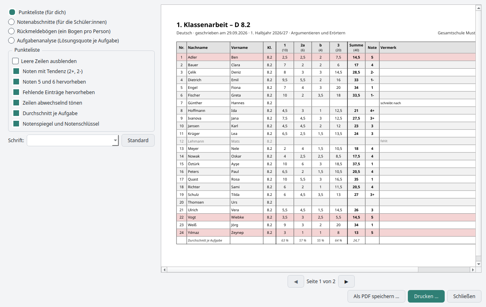

**Notenabschnitte** (für die Schüler:innen) zum Ausschneiden oder auf Etiketten ①: Name, Aufgaben mit Höchst- und
erreichten Punkten, Summe, Datum und Note ohne Tendenz.

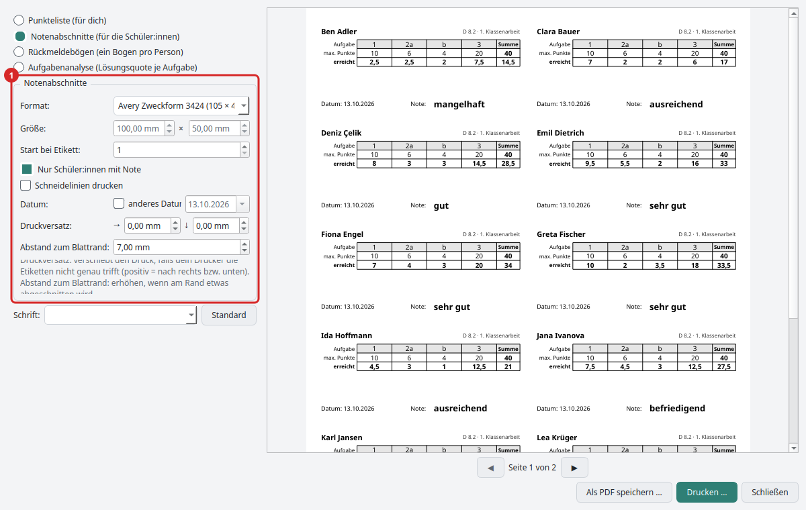

- **Avery Zweckform 3424** (105 × 48 mm, 12 je Bogen) und **3425** (105 × 57 mm, 10 je Bogen), oder **frei**: eigene
  Größe auf Normalpapier mit Schneidelinien.
- **Start bei Etikett:** bei einem angebrochenen Bogen das erste freie Etikett (zeilenweise gezählt).
- **Druckversatz:** Trifft der Drucker die Etiketten nicht genau, verschiebst du den Druck in mm.
- **Abstand zum Blattrand:** Viele Drucker bedrucken die äußersten Millimeter nicht. Der Inhalt hält deshalb
  mindestens 7 mm Abstand; wird am Rand etwas abgeschnitten, den Wert erhöhen.

> **Tipp:** Erst einen Probedruck auf Normalpapier machen und gegen den Etikettenbogen ins Licht halten.

**Rückmeldebögen** – ein Bogen je Person ①: Aufgaben mit Thema und Erwartungshorizont, Punkte, Anteil, Note ohne
Tendenz, deine Rückmeldung und auf Wunsch Unterschriftszeilen.

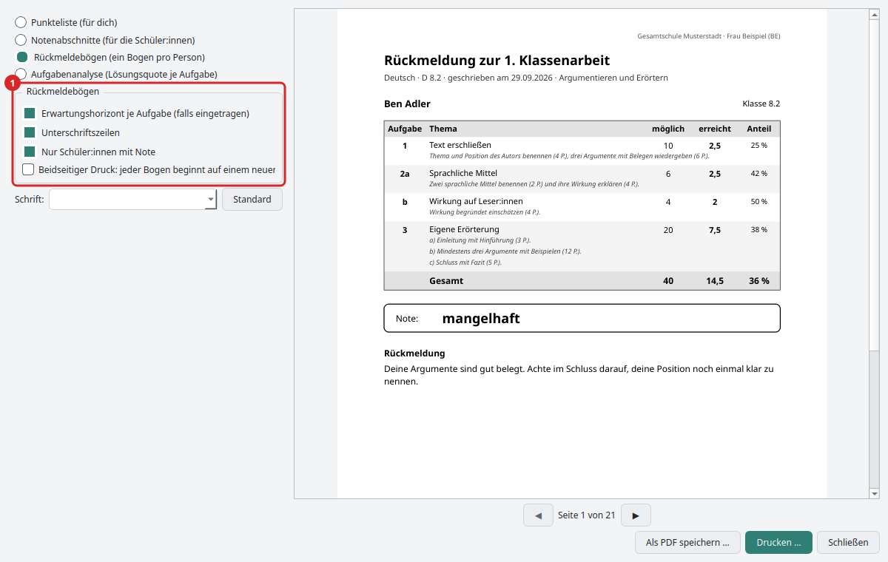

Lange Erwartungshorizonte (etwa aus der KI-Vorlage) setzt das Programm kleiner, für alle Bögen gleich (bis 7 pt).
Reicht das nicht, geht ein Bogen auf einer zweiten Seite weiter; Note, Rückmeldung und Unterschriften stehen dann
zusammen am Ende. Für beidseitigen Druck gibt es „jeder Bogen beginnt auf einem neuen Blatt“. Kürzer wird der
Bogen, wenn du den Erwartungshorizont abwählst.

**Aufgabenanalyse** (wenn eingeschaltet): Lösungsquote je Aufgabe als Balken, ohne Namen.

Die **Kopfzeile** aller Ausdrucke (Schule, Lehrkraft) stellst du unter Datei → Angaben für Ausdrucke ein, die
**Schrift** der Ausdrucke im Druckdialog.

<!-- seitenumbruch -->

## 10 Mündliche Noten

Im Reiter **Mündlich** trägst du die Noten der Sonstigen Mitarbeit je **Zeitraum** ① ein. Standard sind die vier
Quartale. Rechts stehen die Halbjahresmittel.

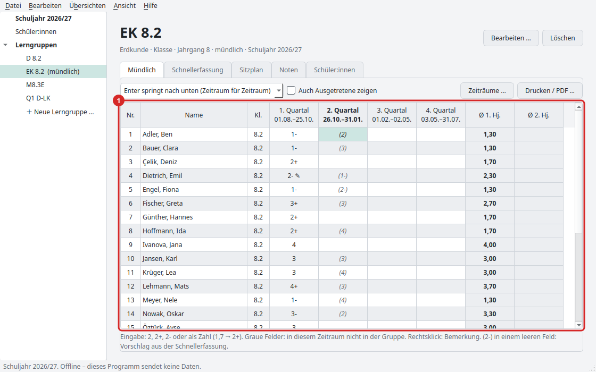

- **Eingabe:** 2, 2+, 2- oder als Zahl (1,7 → 2+). Enter springt nach unten oder nach rechts (oben umschaltbar).
- **Graue Felder:** In diesem Zeitraum war die Person nicht in der Gruppe – keine Note nötig.
- **Rechtsklick → Bemerkung:** eine Notiz zur Note (✎ in der Zelle).
- **Grau in Klammern**, z. B. „(2-)“: ein Vorschlag aus der Schnellerfassung (Kapitel 11). Rechtsklick → „Vorschlag
  übernehmen“ oder einfach selbst eine Note eintippen.
- **Zeiträume …:** umbenennen, Grenzen verschieben, in gleich lange Abschnitte teilen, entfernen oder auf die
  Quartale zurücksetzen. Ein Zeitraum darf nicht über den Halbjahreswechsel gehen.
- **Drucken / PDF …:** Liste der mündlichen Noten (mit oder ohne Tendenz, Halbjahresmittel, Bemerkungen) oder eine
  leere Liste zum Eintragen von Hand.

## 11 Schnellerfassung je Stunde

Im Reiter **Schnellerfassung** notierst du nebenbei, wie jemand in einer Stunde mitgearbeitet hat – so oft oder
selten du willst:

| Eingabe | Bedeutung | Wert |
|---|---|---|
| ++ | sehr gut | 1 |
| + | gut | 2 |
| o | befriedigend | 3 |
| – | schwach | 4 |
| –– | sehr schwach | 5 |

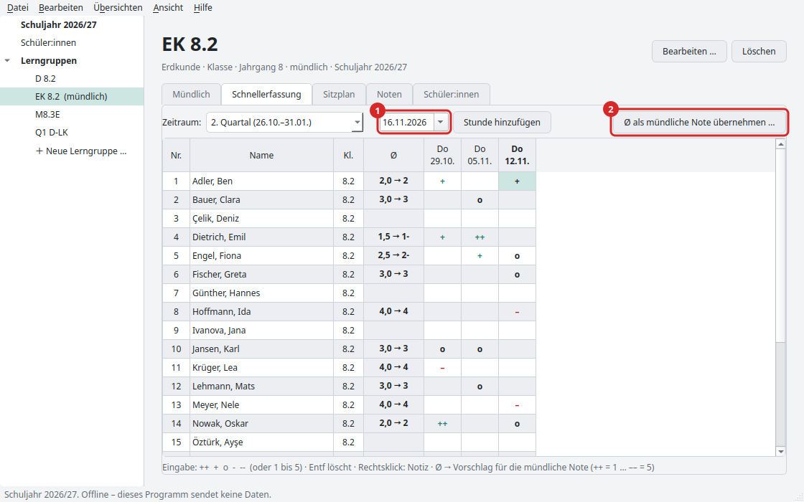

1. Oben den mündlichen **Zeitraum** wählen.
2. Tag wählen ① und „**Stunde hinzufügen**“ – es entsteht eine Spalte für den Tag.
3. Tippen: **++ + o - --** oder **1** bis **5**. Enter springt nach unten, Entf löscht, Rechtsklick bietet die
   Auswahl per Maus und eine **Notiz** (✎).

Die Spalte **Ø** zeigt den Durchschnitt im Zeitraum und die Note, die daraus folgt (z. B. „2,4 → 2-“). Das ist nur
ein **Vorschlag**: Er steht grau im Reiter Mündlich, oder du übernimmst ihn mit „Ø als mündliche Note übernehmen …“
② für alle, die im Zeitraum noch keine mündliche Note haben. Vorhandene Noten bleiben immer unverändert.

<!-- seitenumbruch -->

## 12 Sitzplan

Im Reiter **Sitzplan** legst du einen oder mehrere Pläne je Lerngruppe an, z. B. je Raum („Neuer Plan …“). Die
Tafel ist oben; „Sicht vom Pult“ dreht den Plan so, wie du vorne stehend auf die Klasse schaust. Es gibt drei
Modi ① ② ③.

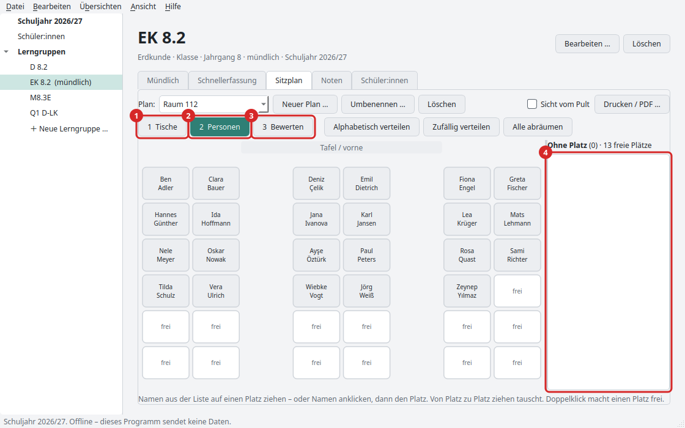

**① Tische:** Eine Vorlage wählen – Reihen mit 2er-Tischen, Gruppentische oder U-Form – und anwenden; dann einzelne
Plätze per Klick setzen oder entfernen. Ziehen mit gedrückter Maus geht über mehrere Felder. Breite und Reihen sind
bis 12 × 12 einstellbar. Wer schon sitzt, behält seinen Platz.

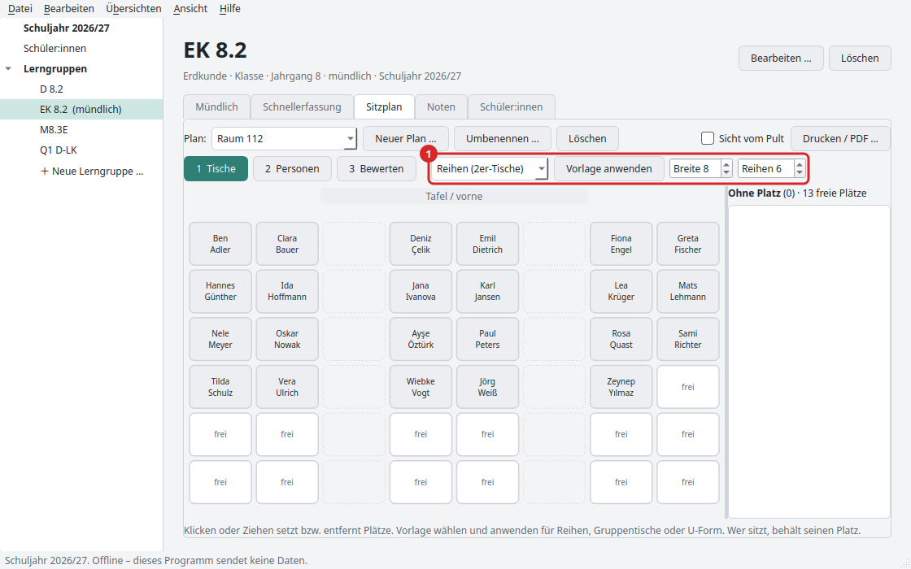

**② Personen:** Namen aus der Liste „Ohne Platz“ ④ auf einen Platz ziehen – oder einen Namen anklicken und dann den
Platz. Von Platz zu Platz ziehen tauscht die beiden, Doppelklick macht einen Platz frei. „Alphabetisch verteilen“
oder „Zufällig verteilen“ füllt die freien Plätze von vorne.

**③ Bewerten:** Tag wählen, auf einen Platz tippen, ++ + o – –– wählen. Das landet in der Schnellerfassung; die
farbige Marke auf dem Platz zeigt die Bewertung des Tages.

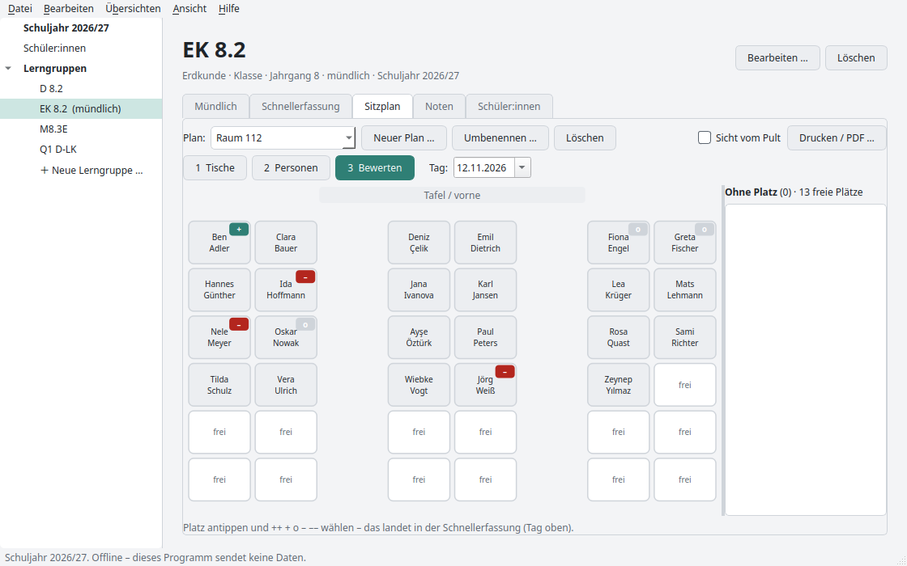

**Drucken / PDF …** gibt den Plan im Querformat aus – nur Namen, ohne Noten, etwa für Vertretungskräfte.

<!-- seitenumbruch -->

## 13 Noten fürs Zeugnis

Der Reiter **Noten** zeigt die Noten in der Reihenfolge der Abgabe:
**1. Quartal – 1. Halbjahr – 3. Quartal – 2. Halbjahr**. Je Abschnitt stehen der schriftliche und der mündliche
Schnitt, ein **Vorschlag** und die Note, die du **festsetzt**.

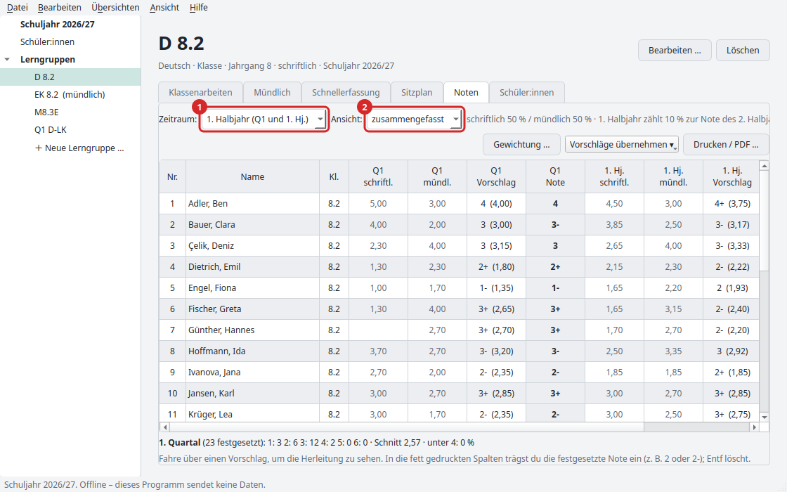

- **Zeitraum** ①: ganzes Jahr oder ein Halbjahr (Standard: das laufende).
- **Ansicht** ②: „zusammengefasst“ oder „mit Einzelnoten“ – dann steht jede Arbeit und jeder mündliche Zeitraum als
  eigene Spalte vor der Note, zu der sie zählen. Graue Einträge zählen nicht (fehlt, befreit, Arbeit zählt nicht).
- **Herleitung:** Fahre mit der Maus über einen Vorschlag – du siehst jede Note und jeden Anteil.
- **Festsetzen:** in die fett gedruckten Spalten tippen (z. B. 2 oder 2-), Entf löscht. Weicht eine Note deutlich
  vom Vorschlag ab, wird sie farbig markiert.
- **Vorschläge übernehmen ▾:** Quartalsnoten mit Tendenz, Halbjahresnoten als ganze Note; wahlweise nur leere
  Felder.

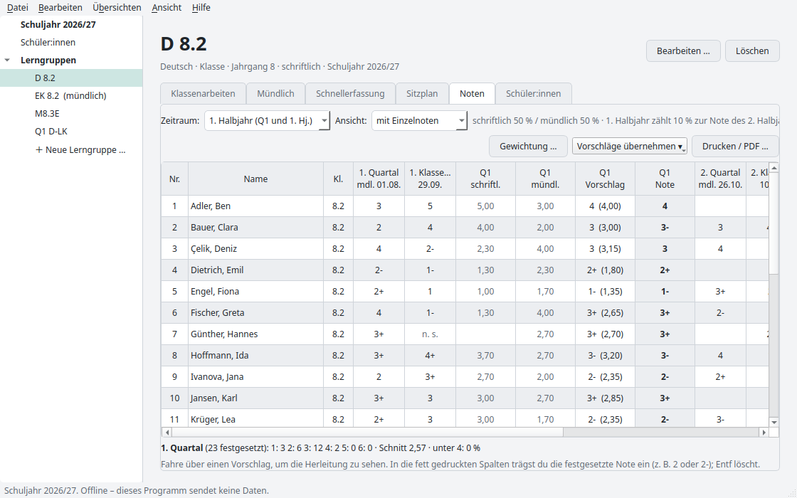

**Gewichtung …** ändert die Anteile für diese Lerngruppe: Anteil schriftlich (Standard 50 % in schriftlichen
Fächern, 0 % in mündlichen), Anteil des 1. Halbjahres an der Note des 2. Halbjahres (Standard 10 %) und ob die
Gruppe ein ZP10-Fach ist.

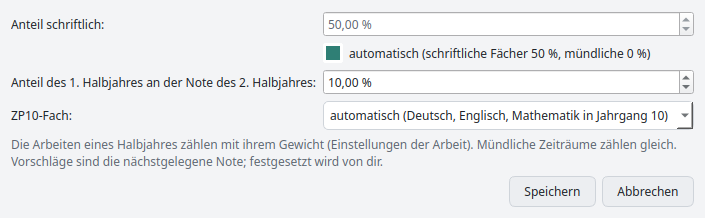

**ZP10:** Deutsch, Englisch und Mathematik in Jahrgang 10 haben eine Vornote aus dem ganzen Jahr; die ZP10-Note
trägst du ein, die Endnote ist 50 % Vornote + 50 % ZP10.

**Notenübersicht drucken:** „Drucken / PDF …“ gibt eine Übersicht im Querformat mit Notenspiegeln je Abschnitt aus.
Passt nicht alles auf die Seite, lässt das Programm zuerst Teilnoten weg – die festgesetzten Noten stehen immer
drauf.

Wie die Vorschläge genau entstehen, steht im Anhang (Kapitel 21).

## 14 Oberstufe (EF, Q1, Q2)

Lerngruppen mit Jahrgang 11 bis 13 arbeiten mit **Punkten von 0 bis 15**. Das Notensystem ergibt sich aus dem
Jahrgang und lässt sich nicht mehr ändern, sobald Noten eingetragen sind.

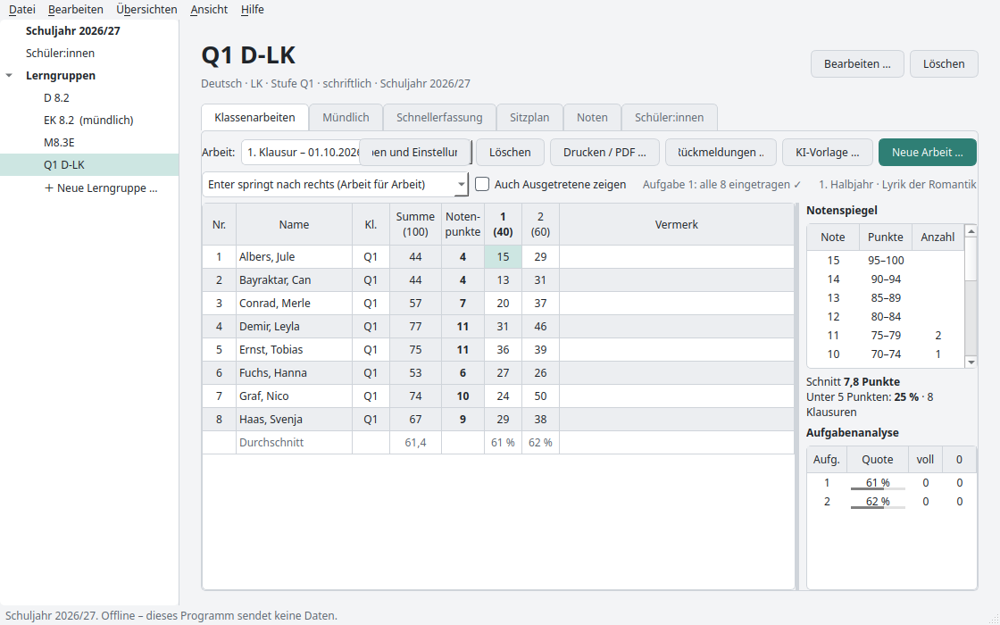

- **Kursart** GK oder LK; schriftlich oder mündlich belegt.
- **Klausuren** wie Klassenarbeiten. Standardschlüssel nach NRW-Tabelle: ab 95 % 15 Punkte, je 5 % weniger ein
  Punkt bis 50 % = 6 Punkte, darunter 45 % = 5, 39 % = 4, 33 % = 3, 27 % = 2, 20 % = 1 Punkt. Pro Klausur änderbar.
  Punkte ohne Klausurpunkte direkt in die Spalte „Notenpunkte“ tippen.
- **Sonstige Mitarbeit** im Reiter Mündlich in Punkten (10,5 → 11).
- **Noten:** Quartals- und Halbjahresnoten in Punkten; Standard 50 % Klausuren / 50 % Sonstige Mitarbeit; die
  Halbjahre werden getrennt bewertet. Der Notenspiegel zählt Punkte, „unter 5 P.“ ist der Anteil der Defizite.
- Nicht enthalten: Abiturzulassung und Abiturprüfungen.

<!-- seitenumbruch -->

## 15 Übersichten

### Offene Punkte

Die Seite **Schuljahr** (links ganz oben; Übersichten → Offene Punkte) zeigt, was noch zu tun ist – siehe das Bild
in Kapitel 3:

- Arbeiten, die schon geschrieben sind, aber noch Lücken haben,
- Nachschreiber:innen ohne Ergebnis,
- mündliche Zeiträume, die vorbei sind, ohne Note – solange die Quartals- bzw. Halbjahresnote noch fehlt,
- fehlende Quartals- und Halbjahresnoten ab drei Wochen vor dem Ende des Zeitraums. Mit ⚠ markiert ist, was in der
  nächsten Woche fällig oder schon überfällig ist.

Doppelklick oder Enter springt direkt zur Stelle.

### Schnellsuche (Strg+F)

Einen Teil des Namens tippen – auch ohne Akzente („oztu“ findet „Öztürk“); mehrere Wörter grenzen ein. Die Liste
zeigt die Person mit allen ihren Lerngruppen, dazu passende Lerngruppen und Arbeiten. ↑ ↓ wählen, Enter öffnet:
Eine Person in einer Lerngruppe öffnet die Gruppe im aktuellen Reiter und markiert ihre Zeile.

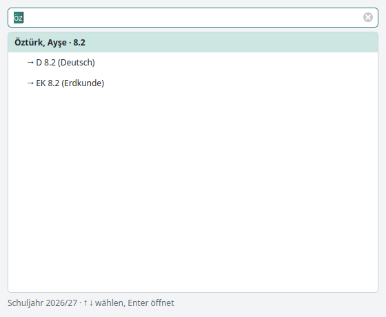

### Nachschreibliste

Übersichten → Nachschreibliste zeigt alle mit „fehlt“ oder „schreibt nach“ aus allen Lerngruppen des Schuljahres.
Doppelklick öffnet die Arbeit. Gedruckt erscheint sie ohne Noten, mit Spalten für Termin, Raum und „erledigt“ –
zum Mitgeben an die Aufsicht. Erledigt ist, wer Punkte oder eine Note hat.

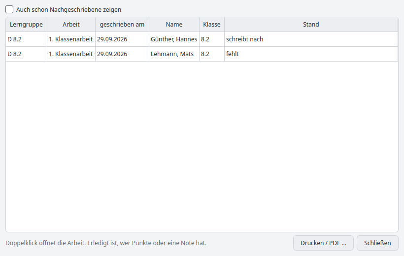

### Schüler:innen-Bogen (Strg+B)

Alles zu einer Person auf einem Bogen – für Elternsprechtag, Zeugniskonferenz oder Beratung: aus allen deinen
Lerngruppen die Zeugnisnoten, Klassenarbeiten mit Punkten, Note, Vermerk und Rückmeldung, mündliche Noten mit
Bemerkungen und die Schnellerfassung mit Notizen. Frühere Schuljahre folgen darunter – so siehst du den Verlauf.

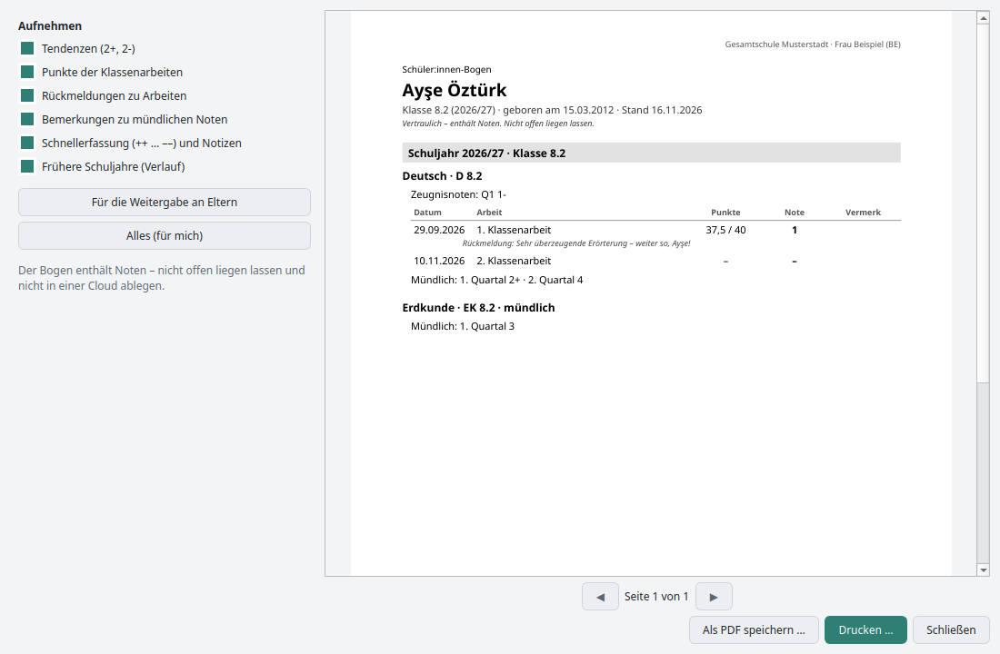

Öffnen: eine Person in einer Tabelle wählen und **Strg+B**, oder in der Liste der Schüler:innen „Schüler:innen-Bogen
…“. Ist niemand gewählt, fragt das Programm nach einem Namen. Links stehen Häkchen zum Weglassen; „**Für die
Weitergabe an Eltern**“ nimmt Tendenzen, Bemerkungen und Schnellerfassung heraus.

## 16 Schuljahreswechsel

Datei → Schuljahr → „**Neues Schuljahr aus bisherigem übernehmen …**“ führt durch vier Schritte:

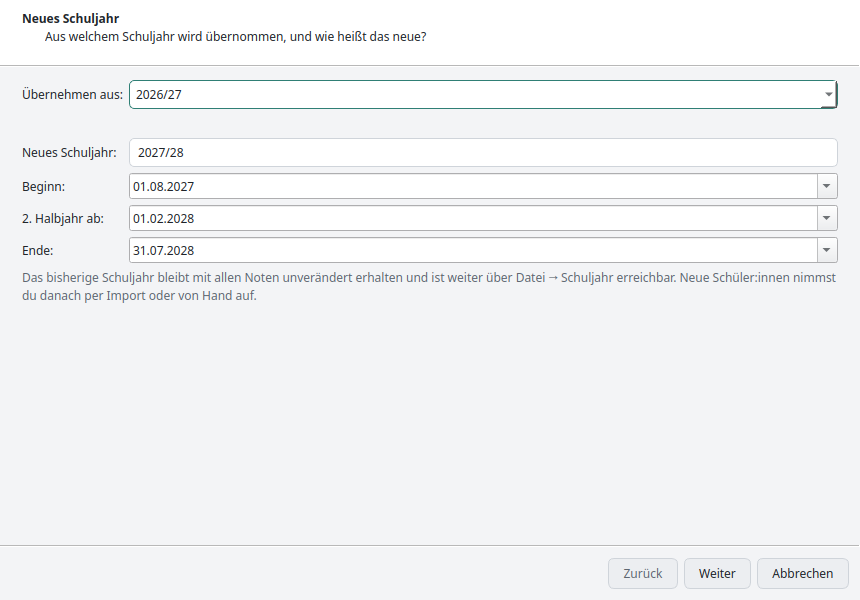

1. **Neues Schuljahr** mit Beginn, Halbjahreswechsel und Ende.
2. **Klassen:** Jede Klasse wird hochgesetzt (8.4 → 9.4, 10.x → EF, EF → Q1 → Q2). Die neue Klasse lässt sich
   ändern; mit „endet“ verlassen alle die Schule (z. B. Abschlussklassen; die Q2 ist vorausgewählt).
3. **Schüler:innen:** Ausnahmen festlegen – wiederholt, verlässt die Schule oder kommt in eine andere Klasse.
4. **Lerngruppen:** welche übernommen werden, mit neuer Bezeichnung. Klassengruppen bekommen alle aus der neuen
   Klasse, Kurse nur die versetzten Mitglieder. Gewichtung und Sortierung ziehen mit.

Das alte Schuljahr bleibt unverändert und ist über Datei → Schuljahr erreichbar. Neue Schüler:innen trägst du danach
wie gewohnt ein oder importierst sie. Ging etwas schief: **Strg+Z** nimmt den ganzen Wechsel zurück.

<!-- seitenumbruch -->

## 17 Sicherheit und Datensicherung

### Wie deine Daten geschützt sind

Die Datenbank ist mit **AES-256** verschlüsselt; der Schlüssel wird aus deinem Passwort mit **Argon2id** abgeleitet,
was Rateversuche stark bremst. Ohne Passwort, Wiederherstellungscode oder Schlüsseldatei kann niemand die Datei
lesen – auch du nicht. Das Programm stellt keine Verbindung ins Internet her.

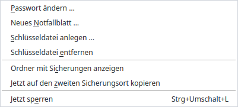

Im Menü **Datei → Sicherheit**:

- **Passwort ändern …** – Die Datenbank bekommt dabei einen **neuen inneren Schlüssel**. So lässt sich eine spätere
  Fassung auch dann nicht öffnen, wenn jemand das alte Passwort und eine alte Kopie der Datei hat. Danach erscheint
  sofort ein **neues Notfallblatt** – der alte Code gilt nicht mehr –, und eine Schlüsseldatei muss neu angelegt
  werden. Alle Sicherungen, auch auf dem zweiten Sicherungsort (wenn er erreichbar ist), werden umgestellt.
- **Neues Notfallblatt …** – ein neuer Wiederherstellungscode; der alte gilt dann nicht mehr.
- **Schlüsseldatei anlegen …** – eine zusätzliche Datei (z. B. auf einem USB-Stick), mit der sich die Datenbank ohne
  Passwort öffnen lässt. Getrennt vom Rechner aufbewahren.
- **Ordner mit Sicherungen anzeigen**, **Jetzt auf den zweiten Sicherungsort kopieren**, **Jetzt sperren**
  (Strg+Umschalt+L).

**Passwort vergessen?** Im Startdialog auf „Passwort vergessen?“ klicken und den Wiederherstellungscode vom
Notfallblatt eintippen (Groß-/Kleinschreibung und Bindestriche sind egal) oder die Schlüsseldatei wählen. Danach
legst du ein neues Passwort fest – und bekommst wie beim Passwortwechsel ein neues Notfallblatt.

### Sicherungen

- **Automatisch:** Bei jeder Sitzung legt das Programm vor dem ersten Speichern eine Sicherung im Ordner
  *Name-Sicherungen* neben der Datenbank an; die letzten 20 bleiben. Eine Sicherung öffnest du wie jede andere
  Datenbank.
- **Vor einer Umstellung** durch eine neue Programmversion bleibt die alte Datei als dauerhafte Sicherung
  „…_vor-Umstellung-…“ erhalten.
- **Zweiter Sicherungsort** (Bearbeiten → Einstellungen): ein Ordner, z. B. auf einem USB-Stick. Beim Schließen der
  Datenbank legt das Programm dort eine verschlüsselte Kopie mit Datum ab und behält die neuesten 10. Ist der Stick
  nicht eingesteckt, wird nur diese Kopie übersprungen.

### Automatisch sperren

Nach **15 Minuten ohne Eingabe** (einstellbar) deckt das Programm alle Fenster ab. Vorher wird gespeichert; auch ein
offener Dialog bleibt erhalten. Weiter geht es mit dem Passwort der Datenbank. Sofort sperren: **Strg+Umschalt+L**.

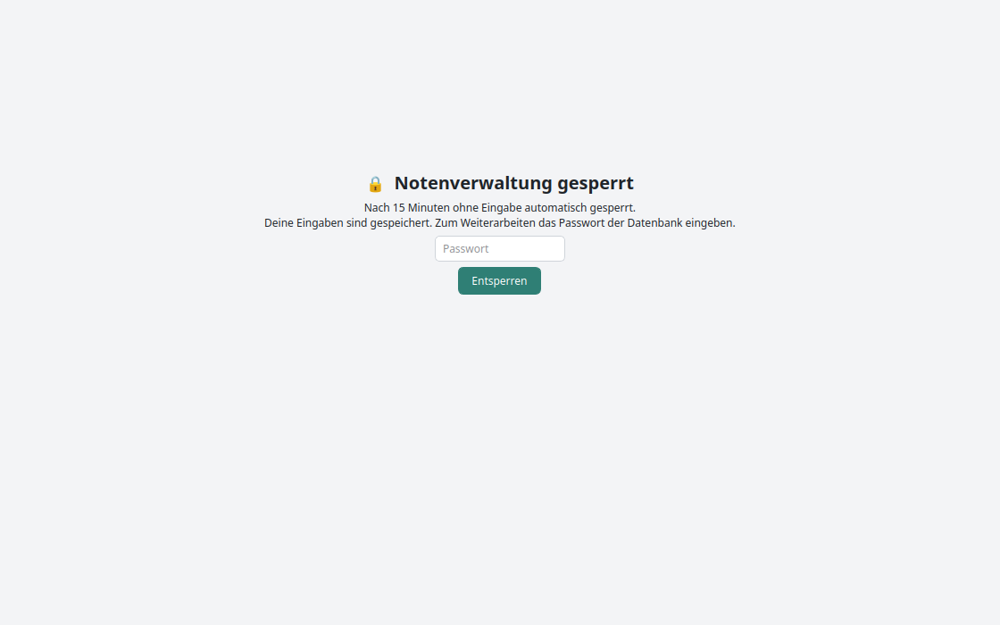

### Was die Verschlüsselung nicht abdeckt

- Die Sperre schützt vor dem Blick auf den Bildschirm, nicht vor jemandem mit Zugriff auf dein angemeldetes Konto.
  Nutze zusätzlich die **Bildschirmsperre des Betriebssystems**.
- **PDF-Dateien und Druckaufträge** sind nicht verschlüsselt – nach dem Drucken löschen.
- Auslagerungsdatei und Ruhezustand können Daten aus dem Arbeitsspeicher enthalten. Am besten ist die
  **Festplatte verschlüsselt** (BitLocker unter Windows, LUKS unter Linux).

## 18 Einstellungen und Darstellung

Unter **Bearbeiten → Einstellungen** (gilt für diesen Rechner, enthält keine Notendaten):

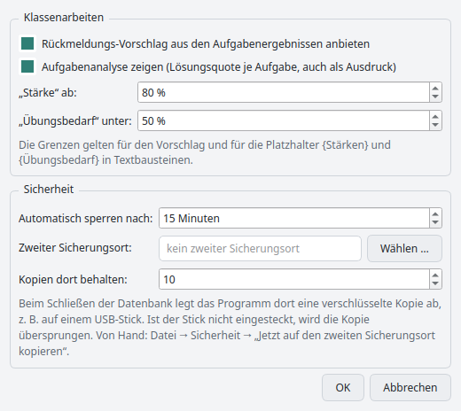

- **Klassenarbeiten:** Rückmeldungs-Vorschlag und Aufgabenanalyse ein- oder ausschalten; ab wie viel Prozent eine
  Aufgabe als Stärke gilt und unter wie viel Prozent als Übungsbedarf (Standard 80 % und 50 %).
- **Sicherheit:** automatisch sperren (0 = nie), zweiter Sicherungsort und wie viele Kopien dort bleiben.

**Darstellung:** Ansicht → Design hell oder dunkel; Ansicht → Schrift …, größer (Strg+Plus), kleiner (Strg+Minus),
Standardschrift. **Kopfzeile der Ausdrucke:** Datei → Angaben für Ausdrucke (Schule, Lehrkraft).

<!-- seitenumbruch -->

## 19 Hilfe, häufige Fragen, Fehler melden

**F1** öffnet überall die Hilfeseite zur aktuellen Ansicht, auch in Dialogen. Das Hilfefenster hat ein
Inhaltsverzeichnis und eine Suche; es funktioniert ohne Internet.

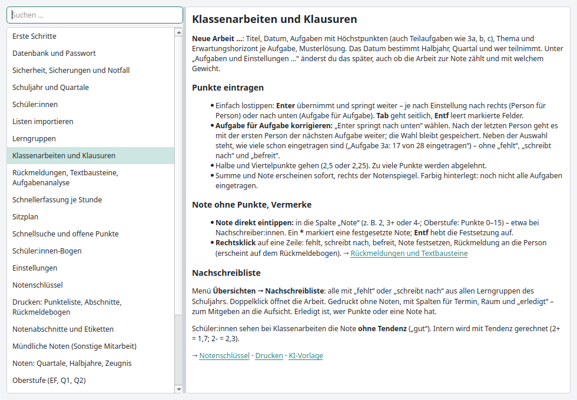

**Auf den Etiketten wird am Rand etwas abgeschnitten.** Im Druckdialog „Abstand zum Blattrand“ erhöhen (z. B. auf
9 mm). Sitzt alles verschoben, den Druckversatz anpassen.

**„Die Datenbank ist bereits geöffnet.“** Sie ist auf einem anderen Rechner offen – oder das Programm wurde dort
nicht ordentlich beendet. Erst dort schließen. Bist du sicher, dass sie nirgends offen ist, kannst du sie trotzdem
öffnen.

**Eine ältere Programmversion öffnet meine Datei nicht mehr.** Die Datei wurde von einer neueren Version umgestellt.
Nimm die neue Version – oder für die alte Version die Sicherung „…_vor-Umstellung-…“.

**Eine Person bekommt keine Note, das Feld ist grau.** Sie war zu diesem Zeitpunkt nicht in der Gruppe (Eintritt,
Austritt oder Abgang). Prüfen im Reiter Schüler:innen → „Eintritt / Austritt …“.

**Der Vorschlag passt nicht zu meiner Erwartung.** Maus über den Vorschlag halten: Die Herleitung zeigt jede Note und
jeden Anteil. Prüfe die Gewichtung, ob jede Arbeit „zählt“ und welches Gewicht sie hat, und welchem Quartal bzw.
Halbjahr Arbeiten und Zeiträume zugeordnet sind.

**Sendet das Programm Daten ins Internet?** Nein. Es stellt keine Verbindung her – weder für Updates noch für
Statistik.

### Fehler melden

Hinweise auf Fehler und Ideen sind willkommen – als *Issue* auf der Projektseite bei GitHub. Bitte **ohne echte
Schülerdaten**: keine Namen, keine Datenbankdateien, keine Bildschirmfotos mit echten Noten. Beschreib, was du getan
hast, was du erwartet hast und was passiert ist; die Programmversion steht unter Hilfe → Über.

## 20 Tastenkürzel

| Taste | Wirkung |
|---|---|
| F1 | Hilfe zur aktuellen Ansicht |
| Strg+N / Strg+O / Strg+S / Strg+W | Neue Datenbank / öffnen / speichern / schließen |
| Strg+L | Neue Lerngruppe |
| Strg+Z / Strg+Y | Rückgängig / Wiederholen |
| Strg+F | Schnellsuche |
| Strg+B | Schüler:innen-Bogen der gewählten Person |
| Strg+Umschalt+L | Programm sofort sperren |
| Strg+Plus / Strg+Minus | Schrift größer / kleiner |
| Strg+Q | Beenden |
| Enter | in Tabellen: übernehmen und weiter |
| Tab / Umschalt+Tab | in Tabellen: seitlich weiter / zurück |
| Entf | markierte Felder leeren bzw. Festsetzung aufheben |
| Esc | Eingabe abbrechen |
| Strg+Leertaste | im Rückmeldungsfenster: Kürzel durch Textbaustein ersetzen |
| Strg+Bild auf / ab | im Rückmeldungsfenster: vorige / nächste Person |

<!-- seitenumbruch -->

## 21 Anhang: So rechnet das Programm

**Noten mit Tendenz:** 1+ = 0,7; 1 = 1,0; 1- = 1,3; 2+ = 1,7; 2 = 2,0; 2- = 2,3 und so weiter.

**Note einer Klassenarbeit:** aus der Summe der Punkte und dem Notenschlüssel der Arbeit (Prozentgrenzen, gerundet
wie in einer Tabellenkalkulation).

**Schriftlicher Schnitt** eines Halbjahres oder Quartals: Mittel der Noten aller Arbeiten, die zählen, gewichtet mit
ihrem Gewicht. Eine Arbeit gehört zum Halbjahr bzw. Quartal ihres Datums.

**Mündlicher Schnitt:** Mittel der mündlichen Noten der Zeiträume; ein Zeitraum gehört zum Quartal, in dem er
beginnt.

**Halbjahresvorschlag:** Anteil schriftlich × schriftlicher Schnitt + (1 − Anteil schriftlich) × mündlicher Schnitt.
Standard: 50 % in schriftlichen Fächern, 0 % in mündlichen. Fehlt eine Seite, zählt die andere allein (die Herleitung weist darauf hin).

**2. Halbjahr:** Die festgesetzte Note des 1. Halbjahres geht mit ihrem Anteil ein (Standard 10 %).

**Quartalsvorschlag:** nur die Leistungen dieses Quartals, gewichtet wie das Halbjahr, ohne Anteil eines anderen
Zeitraums. Quartalsnoten werden mit Tendenz festgesetzt.

**Runden:** Der Vorschlag ist die nächstgelegene Note mit Tendenz; bei Gleichstand die bessere. Halbjahresnoten
werden als ganze Note übernommen; genau ,5 wird zur besseren Note (2,5 → 2).

**ZP10:** Vornote aus allen Leistungen des Schuljahres; Endnote = 50 % Vornote + 50 % ZP10-Note.

**Oberstufe:** dieselben Regeln mit Punkten 0–15; Standard 50 % Klausuren, 50 % Sonstige Mitarbeit, die Halbjahre
getrennt; Schnitte auf ganze Punkte gerundet (,5 → mehr Punkte).

**Schnellerfassung:** ++ = 1 … –– = 5; der Durchschnitt im Zeitraum ergibt den Vorschlag (Sek I: nächste Note mit
Tendenz; Oberstufe: Punkte = 17 − 3 × Durchschnitt, also ++ = 14, o = 8, –– = 2 Punkte).

**Die Note setzt immer du fest.** Alle Vorschläge sind Rechenhilfen.

---

Notenverwaltung · freie Software unter der GNU General Public License, Version 3 oder später – ohne jede
Gewährleistung. Verwendete Software anderer und ihre Lizenzen: Ordner *lizenzen* im Programmpaket.
